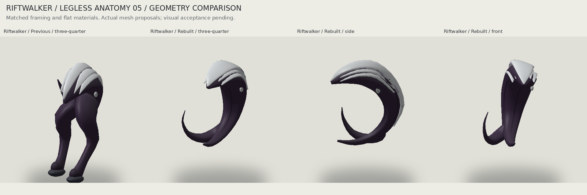

# Riftwalker legless anatomy study 05

## Controlling correction

The creator explicitly approved the legless Vaskel on 2 November 2026. Master Lore Archive v26.0 section 26.17 now supersedes the v25.3 two-limb anatomy and alternating walking description. The locked World Five showcase remains the visual authority. The independent Avarin partner still has its normal anatomy.

## Implementation

The source Vaskel has a continuous curled torso, a tapered flexible counterweight, an attached pale sensory crescent, small embedded pits, secondary eyes, broken channel segments and a compact continuity anchor. There are no Vaskel legs, feet, contact pads, ankle roots or supporting waist web. The suspended pose is a static visual reconstruction, not a claim about flight biology. Unseen contours remain proposed and require visual review.

Source paths remain `SourceArt/Riftwalker/Riftwalker.obj`, `Riftwalker.mtl` and `Textures/`. The reusable identifier remains `Riftwalker`. No gameplay registration, UI, enemy model or existing Unity metadata is changed.

Use **Ninefold > Art > Riftwalker Review > Create a fresh review scene**. The tool creates `Assets/Ninefold/ArtReview/Riftwalker05_<fingerprint>/RiftwalkerStudy05.prefab` and `RiftwalkerReview05.unity`; Unity may suffix the folder to preserve earlier copies. Study 04 scenes do not automatically update. Burdenbeast remains study 04.

The review camera needs the independent Avarin and suspended creature framed together. Do not ground-snap the creature separately. The root remains at ground level for the partner. Walking and new idle animation remain paused; no motion component is attached by the review tool.

## Review and validation

The comparison uses real source geometry with matched flat materials: previous three-quarter, rebuilt three-quarter, side and front. It is not a final fidelity claim. The front view intentionally exposes depth and overlap that the single locked showcase does not resolve.

Python checks cover closed outward nondegenerate parts, zero Vaskel locomotor parts, creature clearance, separate partner placement, scale, texture maps and deterministic regeneration. C# source-import regression expectations now require zero Vaskel limbs and reject obsolete named leg parts. Structural checks cannot certify appearance or detect arbitrary limb geometry hidden under misleading names.

Native Unity editor compilation and visual import must still be checked in Unity 6000.3.21f1. Repository and source checks do not replace that check.
